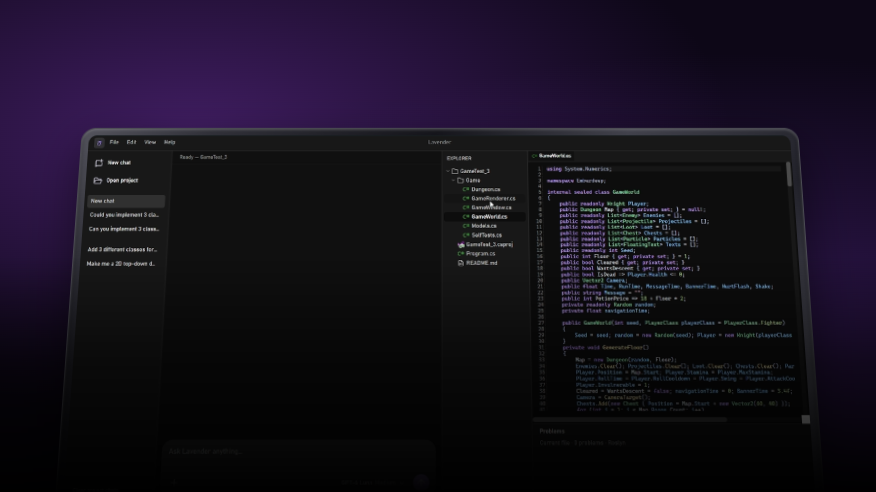

# Lavender

Lavender is a Windows code editor and AI agent workspace for C# and Unity projects, built with WPF and .NET.

## Features

- **Project-aware AI chat:** attach project files, switch configured models and reasoning levels, and follow tool activity as the agent works.
- **Code search and understanding:** Roslyn-based project analysis and semantic search help the agent find relevant code across a project.
- **Agent editing tools:** read and edit project files through integrated tools, with access to project and Git context.
- **Saved conversations:** project-specific chats, persistent history, and summaries of older discussion.
- **Unity integration:** inspect scenes, objects, components, assets, and diagnostics; create objects and modify supported properties through the optional Unity bridge.

## Running locally

### Requirements

- Windows with the .NET 8 SDK.
- Python 3.13 (the version used by the current development environment).
- An OpenAI API key with access to the models you configure.

### Setup

Clone or download the repository, then open PowerShell in the folder containing `Lavender.csproj`.

1. Create the Python environment and install the backend dependencies:

   ```powershell
   py -3.13 -m venv .venv
   .\.venv\Scripts\python.exe -m pip install -r backend\requirements.txt
   ```

2. Set your API key for the current terminal session:

   ```powershell
   $env:OPENAI_API_KEY = "your-api-key"
   ```

   To keep it across sessions, add `OPENAI_API_KEY` to your Windows user environment variables.

3. Review `Agent.Models` in `appsettings.json` and choose model IDs your API account can access. In this public facing repository only OpenAI models were used.

4. Restore and launch the application:

   ```powershell
   dotnet restore Lavender.sln
   dotnet run --project Lavender.csproj
   ```

   Alternatively, open `Lavender.sln` in Visual Studio and run the Lavender project.

### Optional Unity setup

Copy the contents of `integrations/unity/Bridge/` into your Unity project's `Assets/Editor/LavenderBridge/` folder, keeping the `.asmdef` alongside the C# files. Open the same project in Unity and Lavender, and let Unity finish compiling the bridge.

See [Unity tools](docs/unity-tools.md) for installation details and supported operations, and [Unity navigation](docs/unity-navigation.md) for opening scripts in Lavender from Unity.

## Work in progress

Lavender is still being actively worked on. I'm focusing on making the agent more efficient in terms of its API calls, as well as improving how it plans and reasons about tasks through implementing both chain of thought, and tree of thought.

Then, my next milestone for Lavender is to allow the user to develop games through a seperate graph interface in which the agent defines tasks into Node objects which depend on eachother, that the user can configure and edit in real time as the agent is working.

## Credits

Icons from [icon-icons.com](https://icon-icons.com/) and [SVG Repo](https://www.svgrepo.com/).
